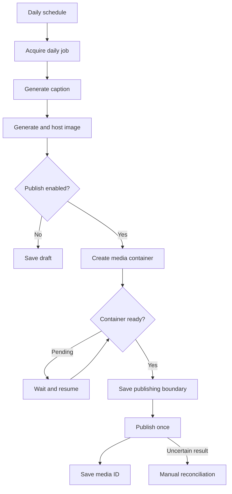

# Daily AI Instagram workflow

## What it does

The importable n8n workflow runs at **09:00 Asia/Kolkata**. It calls one persisted API step at a time, waits 15 seconds, and repeats until complete or 20 steps have been attempted. Long image-generation or Instagram-processing work does not depend on keeping a single Vercel request alive.



The product is selected from active, in-stock records using oldest `lastPostedAt`, then ID. One Firestore document per IST date and mode (`draft`/`live`) prevents duplicate jobs. A transaction and expiring ownership lease protect concurrent invocations. The engine never blindly retries an ambiguous `media_publish` call. Such a job becomes `needs_review`; inspect the saved container and Instagram account before making a manual correction.

## Three modes with different evidence

| Mode          | Image/caption                                                                 | External publishing                                            |
| ------------- | ----------------------------------------------------------------------------- | -------------------------------------------------------------- |
| Local fixture | Existing catalogue image and explicitly labeled deterministic fixture caption | Cannot publish                                                 |
| Real draft    | Gemini caption and configured AI image provider, uploaded to Cloudinary       | Disabled; saved as `dry_run`                                   |
| Live          | Real generated image/caption and official Instagram API                       | Saves returned media ID only after successful publish response |

The admin **Advance draft** action always uses draft mode. It cannot enable live publishing. A standalone sample visual generated in ChatGPT, if included in `automation/examples`, demonstrates the creative output only; it does not prove Gemini, n8n, hosting, or Instagram API execution.

## Configure providers

Set `GEMINI_API_KEY` and `GEMINI_TEXT_MODEL`. The caption request asks for structured introductory text and tags based on catalogue facts. The server adds the canonical product name and retail price. Models can still make errors; review a real draft before activating a public schedule. Sample catalogue prices/specifications must be approved or replaced before advertising real inventory.

For images choose one:

- `AI_IMAGE_PROVIDER=huggingface`: set `HF_TOKEN`, an available `HF_IMAGE_MODEL`, and an inference `HF_PROVIDER` if required.
- `AI_IMAGE_PROVIDER=gemini`: set `GEMINI_IMAGE_MODEL` to an image-capable model available to your account.

Set `CLOUDINARY_CLOUD_NAME`, `CLOUDINARY_API_KEY`, and `CLOUDINARY_API_SECRET`. The server signs uploads and returns an HTTPS, square JPEG transformation. It does not substitute a stock image if the AI provider fails. Model availability, credits and response duration depend on the provider account; none is assumed free or unlimited.

## Instagram direct publishing

The code uses the **official Instagram Platform publishing API**. An eligible professional Instagram account and an authorized Meta app/token are required. Select the matching login flow: `INSTAGRAM_LOGIN_TYPE=instagram` uses `graph.instagram.com`; `facebook` uses `graph.facebook.com`. Configure the account ID, token, a currently supported `META_GRAPH_VERSION`, and the permissions required for that specific flow. Do not mix tokens/account IDs across the two flows.

For Instagram Login, consult the current documentation for `instagram_business_basic` and `instagram_business_content_publish`; the Facebook Login flow has different permissions and linked-Page prerequisites. App review, access level, business roles, token expiry and account restrictions may prevent publication even when the HTTP code is correct. See [Meta's official publishing guide](https://developers.facebook.com/documentation/instagram-platform/content-publishing).

The adapter creates `/{account-id}/media`, polls the container's `status_code`, and calls `/{account-id}/media_publish` only when ready. Images must be publicly retrievable by Meta. Vercel's private preview URLs cannot serve as Instagram media URLs; the workflow uses Cloudinary instead.

Keep `INSTAGRAM_PUBLISH_ENABLED=false` for the first real draft. After reviewing its caption, price and image, set it to `true` in the server environment and redeploy. Run manually once, verify the returned `mediaId` on the actual Instagram account, then activate the schedule. Store long-lived credentials securely and rotate/refresh them through the provider's authorized process before expiry. This assignment does not automate OAuth onboarding or token refresh.

## Import into n8n

1. Use an existing n8n Cloud workspace or an always-on Docker host. For a local trial, copy `automation/.env.example` to `automation/.env`, choose a specific supported n8n version, generate a stable random encryption key, then run `docker compose --env-file automation/.env -f automation/docker-compose.yml up -d`. The supplied Compose file binds to `127.0.0.1:5678` only. A persistent volume keeps workflows/credentials; retain its encryption key with your backup.
2. Open n8n locally and import `automation/workflows/daily-instagram.json`. Imports are intentionally inactive.
3. In **Configure API**, replace the visible example URL with your deployment origin. For a local Docker demonstration, `http://host.docker.internal:8787` reaches the API on the host.
4. Create an **HTTP Header Auth** credential named `Califnco scheduler`: header name `Authorization`, value `Bearer ` followed by the server's `CRON_SECRET`. Select it in **Run one persisted step**. The JSON exports contain no secret.
5. Run **Manual demonstration**. A local fixture ends with `status: dry_run`, `published: false`, `aiGenerated: false`; this is a workflow test, not a published AI post. With real providers, inspect the hosted image and caption in the saved job.
6. Import `expire-orders.json`, replace its API URL, select the same credential, and run it. It frees expired unpaid reservations every 15 minutes. A captured late payment is flagged for review instead of silently fulfilling released stock.
7. Set the workflow timezone to `Asia/Kolkata`, review the daily schedule, and **activate/publish both workflows**. Configure n8n's error notifications and monitor failures. An imported inactive JSON file is not a running schedule.

For internet hosting, use HTTPS and n8n's production deployment guidance; the bundled loopback configuration is for evaluation. n8n is not deployed inside a Vercel Function. The API, Firestore state and workflows are separate components.

## Local reproducible demonstration

```bash
cp .env.demo.example .env
npm run automation:run
```

The CLI advances the same engine until `dry_run`, prints only status, and resumes the same day's saved job on repeat execution. It must not print or embed credentials. View the draft under **AI studio** in the local admin.

## Failure behavior

- Caption/image/container-creation errors: at most three attempts at that stage, then `failed`.
- Pending media: the n8n loop is bounded to 20 calls; inspect and resume if needed.
- Crash while publishing or uncertain publish response: `needs_review`; no automatic republish.
- Invalid scheduler header: 401. Customer attempting admin draft action: 403.
- Price changes before container creation: stops for review rather than publishing the stale price.
- No suitable products: 409; no image generation or publish attempt.
- Email/SMS/FCM alerts without configured providers: recorded as skipped, never labeled sent.

The automated tests use mocks to verify these transitions, including one-publish behavior under repeated/concurrent invocations. They do not certify provider permissions or live delivery. n8n import/execution and live provider checks are listed separately in `TEST_RESULTS.md`.

Official references: [n8n scheduling](https://docs.n8n.io/integrations/builtin/core-nodes/n8n-nodes-base.scheduletrigger/), [n8n encrypted credentials](https://docs.n8n.io/deploy/host-n8n/configure-n8n/basic-configuration/configuration-examples/set-a-custom-encryption-key), [Gemini image generation](https://ai.google.dev/gemini-api/docs/image-generation), [Hugging Face inference](https://huggingface.co/docs/huggingface.js/inference/README).
